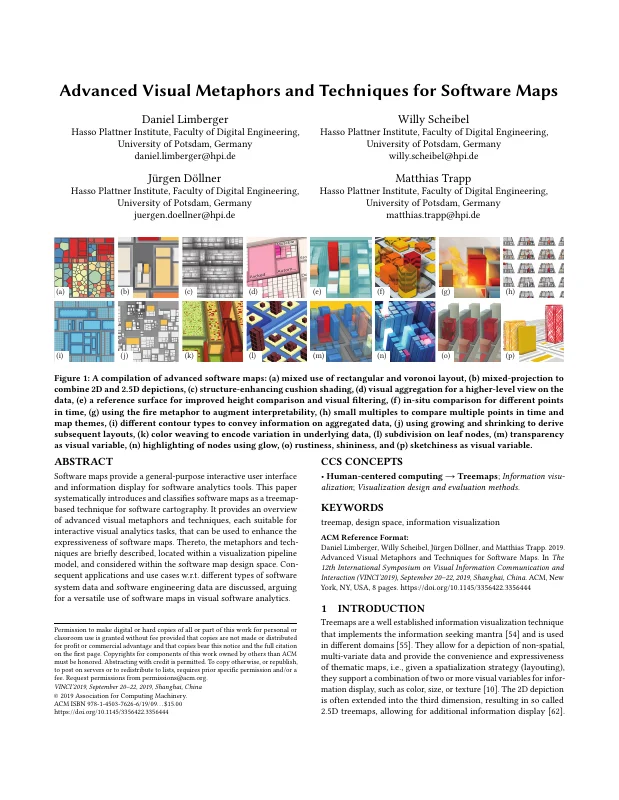
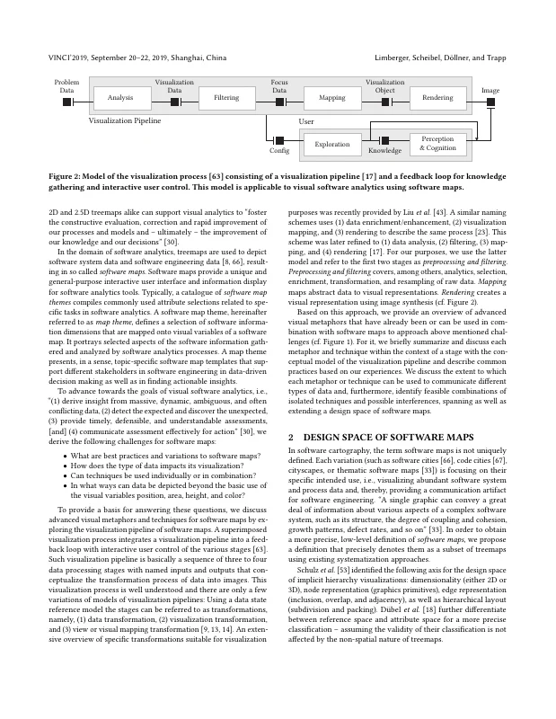
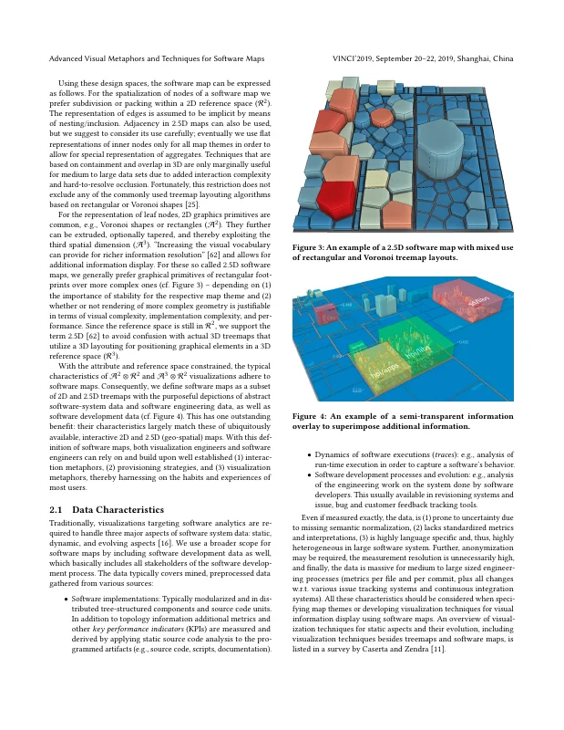
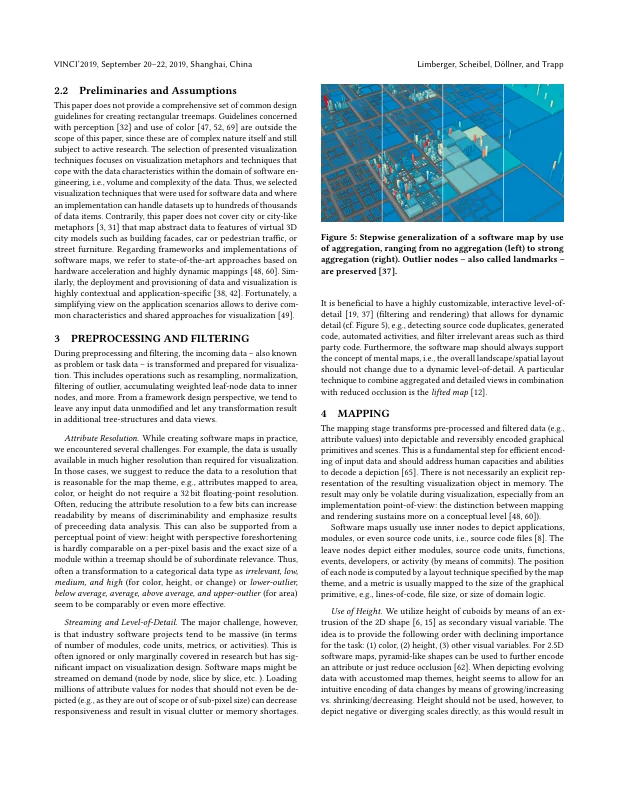
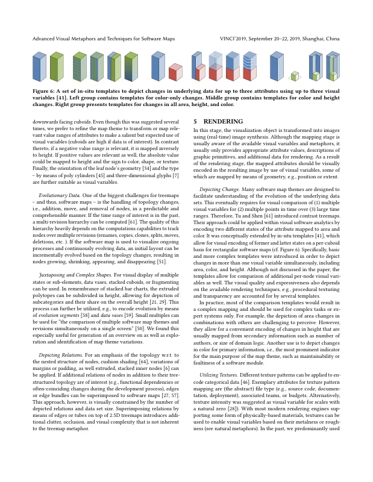
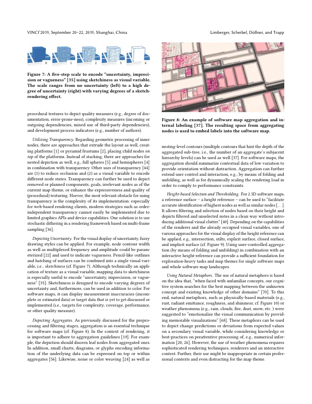
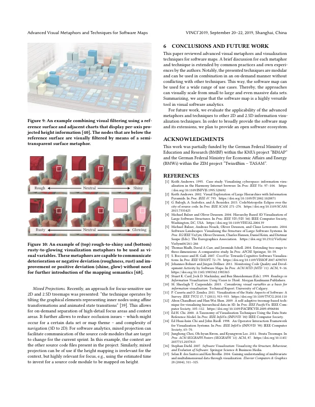
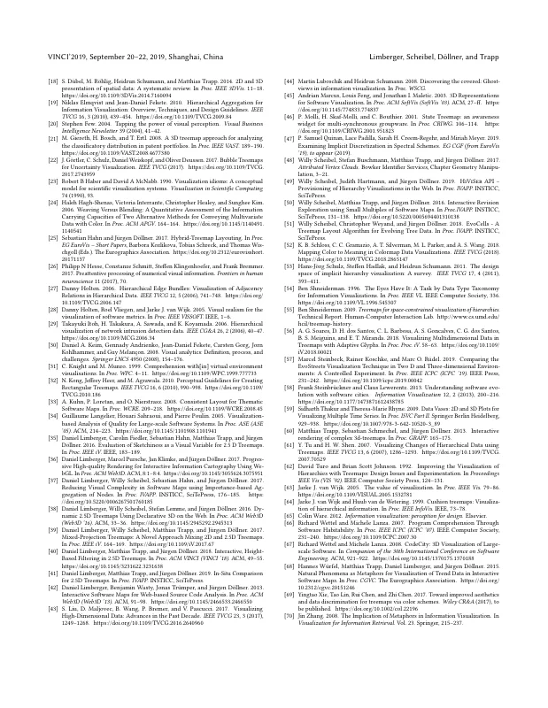

# Advanced Visual Metaphors and Techniques for Software Maps

[Daniel Limberger](https://orcid.org/0000-0002-9111-4809), [Willy Scheibel](https://orcid.org/0000-0002-7885-9857), [Jürgen Döllner](https://orcid.org/0000-0002-8981-8583), and [Matthias Trapp](https://orcid.org/0000-0003-3861-5759)

*Proceedings of the 12th International Symposium on Visual Information Communication and Interaction (VINCI '19)*, September 20–22, 2019, Shanghai, China. ACM, pp. 11:1–8.

DOI: [10.1145/3356422.3356444](https://doi.org/10.1145/3356422.3356444) · Author's version: Zenodo · [ResearchGate](https://www.researchgate.net/publication/335062804)

> Software maps provide a general-purpose interactive user interface and information display for software analytics tools.
> This paper systematically introduces and classifies software maps as a treemap-based technique for software cartography.
> It provides an overview of advanced visual metaphors and techniques, each suitable for interactive visual analytics tasks, that can be used to enhance the expressiveness of software maps.
> Thereto, the metaphors and techniques are briefly described, located within a visualization pipeline model, and considered within the software map design space.
> Consequent applications and use cases w.r.t. different types of software system data and software engineering data are discussed, arguing for a versatile use of software maps in visual software analytics.

<p><a href="limberger2019-advanced-as-submitted.pdf"></a> <a href="limberger2019-advanced-as-submitted.pdf"></a> <a href="limberger2019-advanced-as-submitted.pdf"></a> <a href="limberger2019-advanced-as-submitted.pdf"></a></p>
<details><summary>Remaining 4 pages</summary><p><a href="limberger2019-advanced-as-submitted.pdf"></a> <a href="limberger2019-advanced-as-submitted.pdf"></a> <a href="limberger2019-advanced-as-submitted.pdf"></a> <a href="limberger2019-advanced-as-submitted.pdf"></a></p></details>

## Contents

- [`src/`](src/) – LaTeX sources of the camera-ready version (ACM `acmart` v1.59, sigconf)
- [`limberger2019-advanced-as-submitted.pdf`](limberger2019-advanced-as-submitted.pdf) – camera-ready PDF as submitted to ACM (2019-09-17)
- [`build.sh`](build.sh) – reproducible build with TeX Live 2019 (podman or docker)
- [`preview/`](preview/) – page previews for this README

## Build

```bash
./build.sh          # → build/VINCI-2019-paper-33-cr-sigconf.pdf
./build.sh author   # → build/VINCI-2019-paper-33-cr-sigconf-author.pdf (acmart "authorversion" notice instead of the ACM permission block)
```

`acmart.cls` v1.59 (2019/03/29), which the original was built with, is bundled in `src/` and takes precedence over the TeX Live 2019 version (v1.70).
The sources package sent to ACM referenced the shared project bibliography (`../../../references/references`); `src/references.bib` is that file at the camera-ready commit, reduced to the cited entries.
The build matches `limberger2019-advanced-as-submitted.pdf` in text and layout; only the arrow in the CCS concepts on page 1 renders in a lighter weight.

## Versions

- [`v1.0-camera-ready`](https://github.com/dl-archive/article.2019-vinci-advanced/tree/v1.0-camera-ready) – sources as submitted to ACM

## Citation

```bibtex
@InProceedings{limberger2019-advanced,
  author    = {Limberger, Daniel and Scheibel, Willy and D{\"o}llner, J{\"u}rgen and Trapp, Matthias},
  title     = {Advanced Visual Metaphors and Techniques for Software Maps},
  booktitle = {Proceedings of the 12th International Symposium on Visual Information Communication and Interaction},
  year      = {2019},
  series    = {VINCI~'19},
  publisher = {ACM},
  pages     = {11:1--8},
  doi       = {10.1145/3356422.3356444},
  isbn      = {978-1-450376-26-6},
}
```
